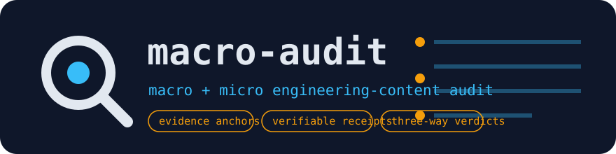
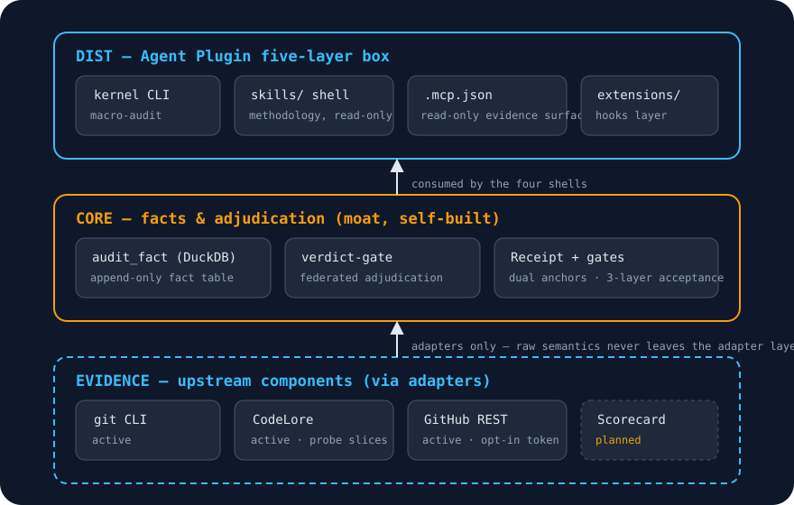

<p align="center">
  
</p>

<p align="center">
  <a href="LICENSE"></a>
  
  
  <a href="#install"></a>
  <a href="https://github.com/Xxx91n/6F/actions/workflows/engine-ci.yml"></a>
</p>

<p align="center"><a href="README.md">English</a> &middot; <a href="README.zh-CN.md">&#31616;&#20307;&#20013;&#25991;</a></p>

6F is a **Claude Code Plugin** that audits a code repository.
> It works best on repositories whose git history is complete and readable.
- Macro-A: how several repos are doing together
- Micro-A: what a pull request changes
- Macro-B: one repo, four quadrants at once
- Micro-B: one file at a time
- Macro-C: how a repo got to where it is

## Install {#install}

**What you need first**: Node.js ≥ 22.18

```text
/plugin marketplace add Xxx91n/6F
/plugin install 6f@xxx91n
```

## How it thinks {#highlights}

- **Facts** :  every claim goes into one table that only grows; old rows are never rewritten. All five scales share that table, and each one draws its own conclusions.
- **Federation** :  every conclusion runs through the same checkpoint (`verdict-gate`), and the rules behind it sit on that shared fact table.
- **Forensics** :  the history scale (Macro-C) treats the repo's own past as evidence.
- **Five scales** :  all five audit scales share one fact table, and all five are planned. This is not one scale cut down and shipped.
- **Frankness** :  preview builds, degraded output, and demo repos marked `synthetic` all say which one they are, under a release that opens up one step at a time.
- **Fingerprints** :  each verdict comes with a receipt and two checks, so you can verify it offline.

> [!NOTE]
> Where it stands: Macro-B, Macro-C, Micro-A, and Micro-B are in preview. Macro-A is still only planned.

## Where it stands {#capability-matrix}

| scale | where it stands |
|---|---|
| Macro-B, one repo, four quadrants | **capability 1 of 5 · preview** (this repo's own first report: [examples/first-report/](examples/first-report/)); the four quadrants: **strategy: active** (S1+S2 data is wired in) · **behavior: preview** (the CodeLore part: churn, hotspots, coupling) · **structure: preview** (the S3 family looks at shape: `structure/shape` readings are observation only; they never feed a verdict) · **supply-chain: queued** (parked in line; Scorecard does not jump ahead) |
| Macro-C, history of one repo | **capability 2 of 5 · preview** (a calibration note for a single repo) |
| Micro-A PR diff | **capability 3 of 5 · preview** (reads data from the middle layer in front of the hosting platform; once that layer was hardened, it became an official way into the engine) |
| Micro-B, one file | **capability 4 of 5 · preview** (`audit file` gives you a file card; the first repos we tried it on are jiahao and env-manager, both ours, for tracking file renames and for calibration: advice only (`advisory`), kept apart from verdicts by design, and advice never turns into a verdict) |
| Macro-A, several repos together | Not yet in preview |

Sources: #85②, D-204③④ (Micro-A made official), D-205 (the structure quadrant), D-034③ (Scorecard stays in line), #51 (the behavior quadrant).

## What a report looks like {#what-a-report-looks-like}

Here is a real excerpt from this repo auditing itself ([examples/first-report/23-first-report.md](examples/first-report/23-first-report.md)):  verdicts are written down exactly as measured, never rounded up:

```text
# MA-23-6F-FIRST-REPORT :  Macro-B first report (6F@fc00d458…)
> RECEIPT RCP-9d20125ad0976c86  facts=228  adjudications=6
> issued_at=2026-09-13T14:31:09+08:00  commit=fc00d458e215…  tree=6f405cfc2ce5

- overall_verdict: unsupported        confidence: 0.75
- headline: main premise falsified at TC-2 (mean_ratio 0.2462 < 0.60,
  Status/Date missing 84.62%); TC-1 INCONCLUSIVE; TC-3 AMBER
```

## Run it yourself {#quick-verification}

From source (Node ≥ 22.18):

```bash
cd engine
npm install
npm test         # generate the manifests, build, then smoke test (does it start and run)
npm run selftest
```
---


## Three layers {#architecture-three-layers}



The outer layer (the CLI, the skills wrapper, the MCP surface) sits on a core we wrote ourselves: one `audit_fact` DuckDB table that only grows, the same verdict check shared by all five scales (`verdict-gate`), and a receipt carrying two checks. Evidence comes in only through the data middle layer, and upstream raw content never leaves it.


## Upstreams {#upstream-components}

| upstream | what it does | form | how it comes in | how it is pinned | status |
|---|---|---|---|---|---|
| DuckDB（@duckdb/node-api） | base for the fact table | Node library | runtime dependency | exact lock in package-lock | 已接入（active） |
| git CLI | dig through repo history / deterministic collection | external CLI | middle layer + external CLI | comes with the host; parsing its output is the contract | 已接入（active） |
| CodeLore | code archaeology, supplies evidence | CLI | middle layer + external CLI | pinned at 0.28.0, plus golden contract tests | 已接入（active；只读检查：explain/summary） |
| OpenSSF Scorecard | supply-chain health score | Go library / CLI | library as a dependency; CLI through the middle layer | hash lock / locked version | 规划中（planned） |
| GitHub REST API | PR data source for the change scale (Micro-A):  list PRs, fetch metadata, fetch diffs, fall back when the platform will not hand it over, local git first | remote-api | middle layer + three-level probe of the env token | X-GitHub-Api-Version fixed + golden cassette contract | 已接入（active） |

Upstreams come in one of two ways: the main route is a data middle layer with an external command or library in front of it; upstreams that ship as libraries get their version and hash pinned in the package manager lockfile. Copying upstream source into the repo is the last resort, only for offline distribution or when the upstream is no longer maintained.

Source: D-020 (the two routes).


## Who owns what {#ownership-boundary}

| owner | component |
|---|---|
| **Ours** | the verdict check all five scales share (`verdict-gate`) · the DuckDB fact table structure (only grows, plus keys that tie rows across scales) · three acceptance gates (A form / B criteria written before the run / C a human overrides the machine) · the receipt with two checks · criteria written before the run (2 positive controls + 3 real criteria + 1 negative control) |
| **Theirs** | the DuckDB engine itself · git CLI · CodeLore (connected · read-only check) · GitHub REST API (connected · REST first, `gh` as an optional fallback) · OpenSSF Scorecard (planned) |

## Rules {#contracts}

- Every data path writes into the fact table **only through the data middle layer**, and upstream raw content never leaves that layer (this layer moves data; business rules stay out of it).
- Replacing or upgrading an upstream **must not touch the fact table structure**:  the structure is fixed, and change only comes through a new version number.
- Every upstream is pinned and comes with a set of golden output tests. Copying upstream source into the repo is only for offline distribution or when the upstream is no longer maintained, and it must carry an UPSTREAM manifest and patches/ rules.

## What is in the repo {#repository-map}

| path | contents |
|---|---|
| [docs/authority.md](docs/authority.md) | the one place that says where a decision goes and where a term goes |
| [GLOSSARY.md](GLOSSARY.md) | glossary:  what each domain word means |
| [docs/spec.md](docs/spec.md) | product decisions (what is not covered yet is in docs/known-gaps.md; accepted risks are in docs/ra/) |
| [docs/adr/](docs/adr/) | architecture decisions (the background, the options we tried, the consequences we took on) |
| [engine/](engine/) | kernel CLI + Agent Plugin, five layers inside (build and command details in [engine/README.md](engine/README.md)) |
| [examples/first-report/](examples/first-report/) | release sample: 6F auditing itself, the four files of its Macro-B first report (one happy, one failure, with the explanation beside them) |
| [engine/CHANGELOG.md](engine/CHANGELOG.md) | what changed in each product version |

## Try it on a real repository {#try-on-a-real-repository}

Someone else's repo only comes in when you hand over the link and say yes:  we clone it into an isolated cache directory (a short sha256 of the URL is the directory name), insist on full history and reject a shallow clone outright, never run anything from the remote config, and reuse the git credentials you already have locally.

```bash
cd engine && npm install && npm run build

# intake: local path | owner/repo (local first) | a link you opt into, cloned into an isolated cache
node dist/cli.js repo add https://github.com/open-gsd/gsd-core.git
node dist/cli.js repo add /path/to/local/repo

# audit: Macro-B is the default scale; Macro-C / Micro-A also run
node dist/cli.js audit /path/to/local/repo
node dist/cli.js audit <repo> --scale Macro-C
node dist/cli.js audit <repo> --scale Micro-A

# Micro-B file card (collect more only for the file you asked about; --db is required)
node dist/cli.js audit file <repo> <file> --db <facts.duckdb> [--at <sha>]
```

- A public repo we tried: [open-gsd/gsd-core](https://github.com/open-gsd/gsd-core) (we really did take it in: on 2026-09-16 we ran Macro-B once, got 1424 facts, and wrote the `unsupported` verdict down as it came out:  TC-2 traced back to us not recognising ADRs written with a dash plus bold, and we logged that as a coverage gap).
- **⚠ someone else's repo keeps changing**:  its content and structure follow its upstream, so readings cannot be expected to match golden:  this example shows how to take a repo in, and promises nothing about any verdict.
- `--scale` only accepts scales that already exist (`Macro-B` / `Macro-C` / `Micro-A`). A scale that does not exist yet returns `SCALE-NOT-IMPLEMENTED` and exit code 2:  the CLI does not pretend to run what is not wired in.

Sources: D-013 (how someone else's repo comes in), A-045 (the gsd-core run record).

<!-- acknowledgments:start — GENERATED by engine/scripts/gen-acknowledgments.mjs; do not edit by hand (regen: node engine/scripts/gen-acknowledgments.mjs) -->
## Acknowledgments {#acknowledgments}

6F builds on these upstream components — the `active` set in [engine/upstream-lock.yaml](engine/upstream-lock.yaml):

- **[CodeLore](https://github.com/emrecdr/codelore)** — code archaeology and evidence-layer external CLI (read-only explain/summary checks)
- **[DuckDB Node API](https://github.com/duckdb/duckdb-node)** — the DuckDB base that every audit scale writes its fact table into (@duckdb/node-api)
- **[DuckDB Node bindings](https://github.com/duckdb/duckdb-node)** — the platform-native DuckDB binaries the fact table runs on (@duckdb/node-bindings-*)
- **[git](https://github.com/git/git)** — deterministic repository history digging and evidence collection (external CLI, provided by the host)
- **[GitHub REST API](https://docs.github.com/rest)** — the PR data source for the change level (Micro-A) — enumeration / metadata / diff fallback, local git first
- **[esbuild](https://github.com/evanw/esbuild)** — single-file dist bundle builder for the packaged CLI
- **[SchemaStore](https://github.com/SchemaStore/schemastore)** — the claude-code-plugin-manifest schema, consumed as a snapshot-as-contract validation source
- **[Claude Code CLI](https://github.com/anthropics/claude-code)** — the claude plugin validate toolchain, used for advice only

*The full upstream record — including planned / evaluating / retired rows — lives in [engine/upstream-lock.yaml](engine/upstream-lock.yaml). Legal attribution obligations are carried by NOTICE/license files; this section is the human-readable credit list only.*
<!-- acknowledgments:end -->
