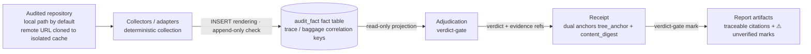

<p align="center">
  
</p>

<a id="macro-audit"></a>
# 6F

<p align="center">
  <a href="LICENSE"></a>
  
  
  <a href="#install"></a>
  <a href="https://github.com/Xxx91n/6F/actions/workflows/engine-ci.yml"></a>
</p>

<p align="center"><a href="README.md">English</a> &middot; <a href="README.zh-CN.md">&#31616;&#20307;&#20013;&#25991;</a></p>

6F audits engineering content, both across repositories and inside one repository, for git-healthy repositories. It ships as a **Claude Code Agent Plugin** ([`engine/`](engine/)). Most evidence comes from upstream components; the adjudication protocol, the fact-table schema, the acceptance gates, and the receipts you can check offline are this project's own work. Five audit scales — Macro-A cross-repo strategy, Macro-B repo quadrant, Macro-C history evolution, Micro-A PR diff, Micro-B single file — share one fact table and one adjudication layer; they differ in when they run and which part of the report they fill.

## Highlights

- **Facts** — every claim lands in one append-only fact table (Hub-of-Facts: one shared fact table, with adjudication done per scale).
- **Federation** — every verdict passes the same `verdict-gate` under that shared setup.
- **Forensics** — history evolution (Macro-C) turns repository history into evidence.
- **Five scales** — five audit scales share that one fact table; all five are the plan, not a cut-down first version.
- **Frankness** — preview, degraded, and `synthetic` output says what it is under the staged preview release model.
- **Fingerprints** — every verdict ships with a receipt anchored two ways, so you can check it offline.


> [!NOTE]
> Status: **preview**. Macro-B, Macro-C, Micro-A, and Micro-B are in preview; Macro-A is **Not yet in preview** — a roadmap note, not a promise you can use. You can install the plugin today from the marketplace (`/plugin marketplace add Xxx91n/6F` → `/plugin install 6f@xxx91n`; acceptance details in [engine/README.md](engine/README.md)). Upstreams marked "planned" are not wired yet, so do not read this page as a finished product. Audit reports and listing copy are mostly in Chinese; this file is the canonical English version.

## Capability matrix

Release cadence = **staged preview releases**: what we plan to build is not the same as when we ship it. All five audit scales are the plan; each one moves through its own preview-to-general-availability path, and a preview is not a cut-down first version.

| scale | status |
|---|---|
| Macro-B repo quadrant | **capability 1 of 5 · preview** (self-audit first report: [examples/first-report/](examples/first-report/)); quadrant statuses: **strategy: active** (S1+S2 collectors live) · **behavior: preview** (codelore churn/hotspot/coupling parts, #51) · **structure: preview** (shape observations from the S3 family — `structure/shape` semantic-domain readings, derived and not used as verdicts, D-205) · **supply-chain: queued** (D-034③ Scorecard does not jump the queue) |
| Macro-C history evolution | **capability 2 of 5 · preview** (single-repo calibration disclosure) |
| Micro-A PR diff | **capability 3 of 5 · preview** (consumer side of the hosted-API adapter; adapter hardening is now an official engine entry point — #85②, D-204③④) |
| Micro-B single file | **capability 4 of 5 · preview** (`audit file` card; same-owner pilot set = jiahao + env-manager two-repo lineage stitching/calibration — `advisory` only, kept apart from verdicts, advisory results never reach gates) |
| Macro-A cross-repo strategy | Not yet in preview |

Honest preview labeling is a decision, not decoration: report headers and sidecars carry a `preview_disclosure` block (capability label + calibration scope + structural limits + not_in_preview list) taken from the same source as the table above. Degraded output carries a `⚠ unverified` mark; evidence domains that are not connected carry a "⚠ data not connected" note; synthetic fixtures carry a `synthetic` mark. None of them pretend to be a real audit.

**0.x rules**: versions only go up and are never reused; a minor version means a contract change, a patch means a fix, and patches are not backported to older lines. The 1.0 exit condition = the report schema is frozen and every wired upstream adapter passes deterministic acceptance — not a date on the calendar. Full policy in [docs/versioning.md](docs/versioning.md); product version history is in [engine/CHANGELOG.md](engine/CHANGELOG.md).

## Install

**Prerequisites**: Node.js ≥ 22.18 (`node --version` to check; 22.18 is the release where built-in TypeScript type stripping became available without a flag, which the contract checks rely on) and Claude Code 2.x.

```text
/plugin marketplace add Xxx91n/6F
/plugin install 6f@xxx91n
```

Marketplace install = git clone with no build step — the runnable `dist/cli.js` (esbuild single-file bundle) ships with the source, and a CI rebuild-diff check catches a forgotten rebuild. Acceptance: `/mcp` shows `macro-audit-kernel` = connected, or run `node dist/cli.js selftest` in the plugin directory (5/5 = alive). Capability tiers and the DuckDB layered self-repair story (CLI auto-fetch vs. MCP `doctor --fix`) are documented in [engine/README.md](engine/README.md).

## What a report looks like

A real excerpt from this repository's self-audit ([examples/first-report/23-first-report.md](examples/first-report/23-first-report.md)) — verdicts are written down as measured, not rounded up:

```text
# MA-23-6F-FIRST-REPORT — Macro-B first report (6F@fc00d458…)
> RECEIPT RCP-9d20125ad0976c86  facts=228  adjudications=6
> issued_at=2026-09-13T14:31:09+08:00  commit=fc00d458e215…  tree=6f405cfc2ce5

- overall_verdict: unsupported        confidence: 0.75
- headline: main premise falsified at TC-2 (mean_ratio 0.2462 < 0.60,
  Status/Date missing 84.62%); TC-1 INCONCLUSIVE; TC-3 AMBER
```

## Quick verification

From source (Node ≥ 22.18):

```bash
cd engine
npm install
npm test         # gen manifests → tsc build → smoke (launch & liveness)
npm run selftest
```

CI loop: [.github/workflows/engine-ci.yml](.github/workflows/engine-ci.yml) (watches `paths: engine/**`).

---

## Architecture: three layers


The distribution layer (CLI, skills shell, MCP surface) sits on a core we built: an append-only `audit_fact` DuckDB fact table, the shared `verdict-gate` adjudication rules, and receipts anchored two ways. Evidence comes in only through adapters; upstream raw semantics never leave the adapter layer.

## Upstream components

| upstream | role | form | integration (D-020 dual-track) | lock strategy | status |
|---|---|---|---|---|---|
| DuckDB（@duckdb/node-api） | fact-table base | Node library | runtime dependency | package-lock exact pin | 已接入（active） |
| git CLI | repository history digging / deterministic collection | external CLI | adapter + external CLI | host environment; output parsing is the contract | 已接入（active） |
| CodeLore | code archaeology / evidence layer | CLI | adapter + external CLI | exact pin 0.28.0 + golden contract tests | 已接入（active; probe surfaces: explain/summary read-only） |
| OpenSSF Scorecard | supply-chain health score | Go library / CLI | library → dependency; CLI → adapter | hash pinning / locked version | 规划中（planned） |
| GitHub REST API | PR data for the change level (Micro-A) — enumeration/metadata/diff fallback; local git first | remote-api | adapter + env token three-level probe | X-GitHub-Api-Version pin + golden cassette contract | 已接入（active） |

> **Status column = 机读权威绑定 (machine-readable binding)**: 唯一权威 = [`engine/upstream-lock.yaml`](engine/upstream-lock.yaml) (D-037③) — this table is for people; status mapping = 已接入→active／规划中→planned／评估中→evaluating (retired rows are omitted; the lock file also carries the evaluating row `codelore-sqlite-dump`). Lock rule: 禁 range/浮动 tag/latest; updates go through a 手动窗口 + golden 回归 ([docs/versioning.md](docs/versioning.md) §3-4).

Integration follows the dual-track adapter rule: adapter + external CLI/library is the main line; library-form upstreams are pinned by package-manager lockfile hashes; copying upstream source into the repo is a last resort for air-gapped distribution or abandoned upstreams.

## Runtime view



## Ownership boundary

| owner | component |
|---|---|
| **Ours (our own work)** | the shared verdict-gate adjudication protocol · DuckDB fact-table schema (append-only + cross-scale correlation keys) · three-layer acceptance gates (A formal / B kill criteria / C override) · receipts anchored two ways · the kill-criterion rule (2 positive controls + 3 real criteria + 1 negative control) |
| **Borrowed (upstream)** | the DuckDB engine itself · git CLI · CodeLore (active, read-only probe surfaces) · GitHub REST API (active, REST primary + optional `gh` fallback) · OpenSSF Scorecard (planned) |

## Contracts

- Upstream components write into the fact table **only through adapters**; upstream raw semantics never leave the adapter layer (anti-corruption rule: no business rules in adapters).
- Replacing or upgrading an upstream **must not change the fact-table schema** — the schema is fixed; change only goes through version numbers.
- Every upstream is version-pinned with golden output contract tests; copied upstream source enters the repo only for air-gapped distribution or abandoned upstreams, and must carry an UPSTREAM manifest and patches/ rules.

## Repository map

| path | contents |
|---|---|
| [docs/authority.md](docs/authority.md) | where decisions and terms are written — the one place that says it |
| [GLOSSARY.md](GLOSSARY.md) | the glossary: what each domain term means |
| [docs/spec.md](docs/spec.md) | product decisions (gaps: docs/known-gaps.md; risk records: docs/ra/) |
| [docs/adr/](docs/adr/) | architecture decisions (context / options / consequences) |
| [engine/](engine/) | kernel CLI + Agent Plugin five-layer box (build / command details in [engine/README.md](engine/README.md)) |
| [examples/first-report/](examples/first-report/) | release sample assets: 6F self-audit Macro-B first report, four files (happy + failure pair, disclosure rules) |
| [engine/CHANGELOG.md](engine/CHANGELOG.md) | product version record |

## Demo and examples

- **Deterministic demo** (zero external dependencies, discard after the run): `node dist/cli.js demo` — a fixture generator builds a temporary git repo and runs the Macro-B chain end to end; three scenarios via `node dist/cli.js demo --list` (happy-path / degraded-supply / degraded-incomplete). Synthetic fixtures carry a `synthetic` disclosure mark — they do not pretend to be real audits.
- **Real first-report sample**: [examples/first-report/](examples/first-report/) — the 6F self-audit Macro-B run, four files (happy + failure pair), with the generating commit, date, regeneration command, and freeze-point attributes written down.

## Try on a real repository

External repositories join via URL opt-in (D-013 local-first + URL opt-in): clone into an isolated cache (sha256 key) + full-depth verification + shallow clones rejected + remote-config execution disabled + local git credential chain reused.

```bash
cd engine && npm install && npm run build

# intake: local path | owner/repo (local-first) | URL opt-in isolated clone
node dist/cli.js repo add https://github.com/open-gsd/gsd-core.git
node dist/cli.js repo add /path/to/local/repo

# audit: first-class command — Macro-B default; Macro-C / Micro-A also shipped
node dist/cli.js audit /path/to/local/repo
node dist/cli.js audit <repo> --scale Macro-C
node dist/cli.js audit <repo> --scale Micro-A

# Micro-B file card (lazy supplementary collection, --db required)
node dist/cli.js audit file <repo> <file> --db <facts.duckdb> [--at <sha>]
```

- Opt-in public example: [open-gsd/gsd-core](https://github.com/open-gsd/gsd-core) (onboarded here: a Macro-B one-shot on 2026-09-16 produced 1424 facts and an `unsupported` verdict written down as measured — TC-2 traced to an ADR dash+bold form detector gap, registered as a coverage hole; the run record is in execution record A-045).
- **⚠ external content changes with its upstream**: external repo content/structure evolves with its upstream, so audit readings cannot be golden-expected — the example shows the intake path, not a promised verdict.
- `--scale` accepts only the shipped scales (`Macro-B` / `Macro-C` / `Micro-A`); a scale that is not implemented is rejected with structured `SCALE-NOT-IMPLEMENTED` + exit 2 — the CLI does not pretend to run scales that are not wired.

<!-- acknowledgments:start — GENERATED by engine/scripts/gen-acknowledgments.mjs; do not edit by hand (regen: node engine/scripts/gen-acknowledgments.mjs) -->
## Acknowledgments

6F builds on these upstream components — the `active` set in [engine/upstream-lock.yaml](engine/upstream-lock.yaml):

- **[CodeLore](https://github.com/emrecdr/codelore)** — code archaeology and evidence-layer external CLI (read-only explain/summary probes)
- **[DuckDB Node API](https://github.com/duckdb/duckdb-node)** — the DuckDB base that every audit scale writes its fact table into (@duckdb/node-api)
- **[DuckDB Node bindings](https://github.com/duckdb/duckdb-node)** — the platform-native DuckDB binaries the fact table runs on (@duckdb/node-bindings-*)
- **[git](https://github.com/git/git)** — deterministic repository history digging and evidence collection (external CLI, provided by the host)
- **[GitHub REST API](https://docs.github.com/rest)** — the PR data source for the change level (Micro-A) — enumeration / metadata / diff fallback, local git first
- **[esbuild](https://github.com/evanw/esbuild)** — single-file dist bundle builder for the packaged CLI
- **[SchemaStore](https://github.com/SchemaStore/schemastore)** — the claude-code-plugin-manifest schema, consumed as a snapshot-as-contract validation source
- **[Claude Code CLI](https://github.com/anthropics/claude-code)** — the claude plugin validate toolchain, used for advice only

*The full upstream record — including planned / evaluating / retired rows — lives in [engine/upstream-lock.yaml](engine/upstream-lock.yaml). Legal attribution obligations are carried by NOTICE/license files; this section is the human-readable credit list only.*
<!-- acknowledgments:end -->

## Honesty notes

- **Badges show only what is true today**: license, version, Node floor, marketplace installability, and the engine-ci main-branch status badge (mounted 2026-09-22 after the first green main run — `event_bound`, not speculation). A motion GIF will be recorded against the real UI after the listing-material freeze — it is not referenced before it exists.
- **Preview means preview**: capability labels, ⚠ marks, and `synthetic` marks are key honesty signals, kept word for word in both language versions.
- **Two-layer front page**: the upper half of this file is the product front page; everything below the rule is the engineering layer (architecture, upstreams, runtime view, ownership, contracts, repo map), kept whole for evaluators who want to check the work.
