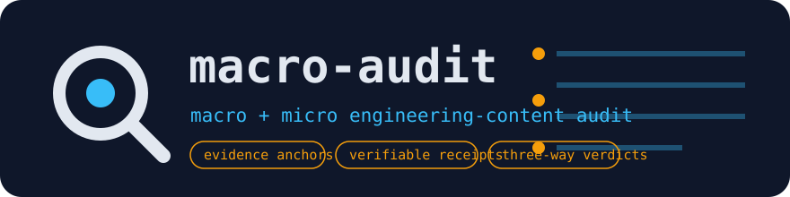
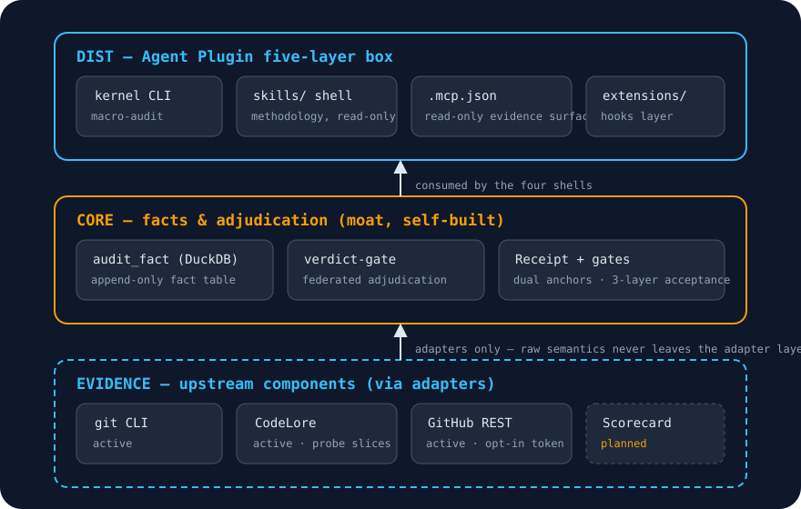
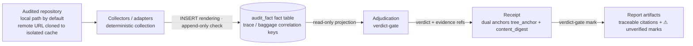

<!-- canonical: README.md | owner: Xxx91n -->
<!-- sync: 570746f9a2dd -->
> ⚠ **本文件是中文译文（derived 译本）——英文版 [README.md](README.md) 是权威版本（canonical 正本）；两边对不上时，以英文版为准。** 译文可以暂时落后，但不假装跟英文版同步（sync 戳跟着英文版内容指纹走）。

<p align="center">
  
</p>

<a id="macro-audit"></a>
# 6F — 跨仓和单仓的工程内容审计 {#6f}

<p align="center">
  <a href="LICENSE"></a>
  
  
  <a href="#install"></a>
  <a href="https://github.com/Xxx91n/6F/actions/workflows/engine-ci.yml"></a>
</p>

<p align="center"><a href="README.md">English</a> &middot; <a href="README.zh-CN.md">&#31616;&#20307;&#20013;&#25991;</a></p>

6F 做的是工程内容审计：既能一次看多个仓库，也能只看一个仓库，面向 git 记录健全的仓库。分发形态是 **Claude Code Agent Plugin**（代码在 [`engine/`](engine/)）。证据大部分来自上游组件；裁决规则、事实表结构、验收关卡和能离线复查的回执，是本项目自己做的。五档审计——Macro-A 跨仓战略档、Macro-B 单仓四象限档、Macro-C 历史演化档、Micro-A 改动档（PR 档）、Micro-B 单文件档——共用一张事实表和一套裁决规则；不一样的地方是它们什么时候跑、报告里填哪一部分。

<a id="highlights"></a>
## 亮点 {#highlights}

- **事实（Facts）** — 每条说法都落进同一张只追加的事实表（Hub-of-Facts：一张共享事实表，各档自己做裁决）。
- **分档裁决（Federation）** — 每条结论都过同一个 `verdict-gate` 裁决闸，规则建立在上面那张共享事实表上。
- **看历史（Forensics）** — 历史演化档（Macro-C）把仓库历史变成证据。
- **五档（Five scales）** — 五档审计共用一张事实表；五档都在计划里，不是砍出来的第一版。
- **诚实（Frankness）** — 预览版、降级产物和带 `synthetic` 标记的东西，会明说自己是哪种，按分阶段预览发布来标。
- **可复查（Fingerprints）** — 每条结论都附一张双锚回执，离线也能自己查。


> [!NOTE]
> 当前状态：**preview 形态**——Macro-B、Macro-C、Micro-A、Micro-B 四档在预览；Macro-A 是 **Not yet in preview**（路线图上写着，不是现在能用的承诺）。插件今天就能从市场安装（`/plugin marketplace add Xxx91n/6F` → `/plugin install 6f@xxx91n`，安装和验收细节见 [engine/README.md](engine/README.md)）。标着「planned」的上游还没接上，别把这一页当成做完的产品。审计报告和上架文案主要用中文；本文件是英文版 [README.md](README.md) 的中文译本。

<a id="capability-matrix"></a>
## 能力状态表 {#capability-matrix}

发布节奏 = **分阶段预览发布**：计划做什么，不等于什么时候发。五档审计都在计划里；每一档自己从预览版走到正式版，预览版不等于砍出来的第一版。

| scale | 状态 |
|---|---|
| Macro-B 单仓四象限档 | **capability 1 of 5 · preview**（自审首报样例见 [examples/first-report/](examples/first-report/)）；四象限状态：**strategy: active**（S1+S2 采集已接）· **behavior: preview**（codelore 的 churn/hotspot/coupling 那部分，#51）· **structure: preview**（S3 族的形态观测——`structure/shape` 这个读数归属层里的读数，只作观测不作判定，D-205）· **supply-chain: queued**（D-034③ Scorecard 不插队） |
| Macro-C 历史演化档 | **capability 2 of 5 · preview**（单仓校准披露） |
| Micro-A PR diff | **capability 3 of 5 · preview**（托管平台接口适配器的使用方；适配器加固已经成了 engine 的正式入口——#85②，D-204③④） |
| Micro-B 单文件档 | **capability 4 of 5 · preview**（`audit file` 文件卡；试点仓是同主双仓 jiahao 和 env-manager 的血缘缝合/校准——只给建议（`advisory` / advisory-only），结构上和裁决隔开，建议永远不进裁决闸） |
| Macro-A 跨仓战略档 | Not yet in preview |

预览标记写清楚是定下来的规矩，不是装饰：报告头和 sidecar 里带 `preview_disclosure` 预览披露块（能力标注 + 校准范围 + 结构性限制 + not_in_preview 清单），和上表用的是同一份意思。降级产物带 `⚠ unverified` 标记；没接上的证据域带「⚠ 数据未接」说明；合成 fixture 带 `synthetic` 标记。它们都不会冒充真实审计。

**0.x 版本规则**：版本号只往上涨，不复用；minor 是契约变更，patch 是修复，旧版本线不回头补 patch。1.0 的退出条件 = 报告 schema 冻结，并且接上的每个上游适配器都通过确定性验收——不看日历。完整规则见 [docs/versioning.md](docs/versioning.md)；产品版本记录在 [engine/CHANGELOG.md](engine/CHANGELOG.md)。

<a id="install"></a>
## 安装 {#install}

**前置条件**：Node.js ≥ 22.18（用 `node --version` 自查；22.18 起内置 TypeScript 类型剥离不用加 flag，契约检查靠这个）；Claude Code 2.x。

```text
/plugin marketplace add Xxx91n/6F
/plugin install 6f@xxx91n
```

市场安装 = git clone，没有构建步骤——能直接跑的 `dist/cli.js`（esbuild 打成的单文件包）跟源码一起进仓；谁忘了重新 build，CI 的 rebuild-diff 检查会拦住。验收：`/mcp` 看到 `macro-audit-kernel` = connected；或者在插件目录跑 `node dist/cli.js selftest`（5/5 就是活的）。能力分层和 DuckDB 分层自动修复（命令行自动补拉 vs MCP `doctor --fix`）写在 [engine/README.md](engine/README.md)。

<a id="what-a-report-looks-like"></a>
## 报告长什么样 {#what-a-report-looks-like}

这是本仓自审的一份真实节选（[examples/first-report/23-first-report.md](examples/first-report/23-first-report.md)）——判定按测到的写下去，不四舍五入：

```text
# MA-23-6F-FIRST-REPORT — Macro-B first report (6F@fc00d458…)
> RECEIPT RCP-9d20125ad0976c86  facts=228  adjudications=6
> issued_at=2026-09-13T14:31:09+08:00  commit=fc00d458e215…  tree=6f405cfc2ce5

- overall_verdict: unsupported        confidence: 0.75
- headline: main premise falsified at TC-2 (mean_ratio 0.2462 < 0.60,
  Status/Date missing 84.62%); TC-1 INCONCLUSIVE; TC-3 AMBER
```

<a id="quick-verification"></a>
## 快速验证 {#quick-verification}

从源码跑（Node ≥ 22.18）：

```bash
cd engine
npm install
npm test         # gen manifests → tsc build → smoke (launch & liveness)
npm run selftest
```

CI 流程见 [.github/workflows/engine-ci.yml](.github/workflows/engine-ci.yml)（`paths: engine/**` 触发）。

---

<a id="architecture-three-layers"></a>
## 三层架构 {#architecture-three-layers}



分发层（CLI、skills 外壳、MCP 面）架在我们自己做的核心上：只追加的 `audit_fact` DuckDB 事实表、共享的 `verdict-gate` 裁决规则，加上双锚回执。证据只能通过适配器进来；上游原始语义不出适配层。

<a id="upstream-components"></a>
## 上游组件 {#upstream-components}

| 上游组件 | 作用 | 形态 | 引入方式（D-020 双轨接入） | 锁定方式 | 状态 |
|---|---|---|---|---|---|
| DuckDB（@duckdb/node-api） | 事实表底座 | Node 库 | 运行时依赖 | package-lock 精确锁定 | 已接入（active） |
| git CLI | 挖仓库历史 / 确定性采集 | 外部 CLI | 适配器 + 外部 CLI | 随宿主环境；输出解析就是契约 | 已接入（active） |
| CodeLore | 代码考古 / 证据层 | CLI | 适配器 + 外部 CLI | exact pin 0.28.0 + golden 契约测试 | 已接入（active；探针：explain/summary 只读） |
| OpenSSF Scorecard | 供应链健康评分 | Go 库 / CLI | 库→依赖；CLI→适配器 | hash 锁定 / 锁版本 | 规划中（planned） |
| GitHub REST API | 改动档（Micro-A）的 PR 数据源——枚举/元数据/diff 兜底；本地 git 优先 | remote-api | 适配器 + 环境变量 token 三级探测 | X-GitHub-Api-Version 固定 + golden cassette 契约 | 已接入（active） |

> **状态列 = 机读权威绑定（机器读这份关系）**：唯一权威 = [`engine/upstream-lock.yaml`](engine/upstream-lock.yaml)（D-037③）——这张表是给人看的；状态映射 = 已接入→active／规划中→planned／评估中→evaluating（retired 行不在表里；锁表还有一条评估中的 `codelore-sqlite-dump`）。锁定规则：禁 range/浮动 tag/latest，改动走手动窗口加 golden 回归（[docs/versioning.md](docs/versioning.md) §3-4）。

引入方式按双轨接入：适配器 + 外部 CLI/库是主线；库形态的上游用包管理器 lockfile 的 hash 固定；把上游源码拷进仓，只在气隙分发或上游废弃时用，是最后的退路。

<a id="runtime-view"></a>
## 运行时视图 {#runtime-view}



<a id="ownership-boundary"></a>
## 谁负责什么 {#ownership-boundary}

| 归属 | 组件 |
|---|---|
| **我们的（自己做的硬本事）** | 共享的裁决闸规则（verdict-gate）· DuckDB 事实表结构（只追加 + 跨档关联键）· 三层验收闸（A 形式 / B 事前判据 / C 人工改判）· 双锚回执 · 事前判据规则（2 个正对照 + 3 条真判据 + 1 个负对照） |
| **借来的（上游）** | DuckDB 引擎本体 · git CLI · CodeLore（已接入·只读探针）· GitHub REST API（已接入·REST 为主 + `gh` 可选回退）· OpenSSF Scorecard（规划中） |

<a id="contracts"></a>
## 约定 {#contracts}

- 上游组件一律**通过适配器**写事实表；上游原始语义不出适配层（防腐层规则：适配层不放业务规则）。
- 换掉或升级上游**不许改事实表结构**——结构固定，要变只能走版本号。
- 每个上游都锁版本，并配 golden 输出契约测试；把上游源码拷进仓，只在气隙分发或上游废弃时用，而且必须带 UPSTREAM 清单和 patches/ 规则。

<a id="repository-map"></a>
## 仓库里有什么 {#repository-map}

| 路径 | 内容 |
|---|---|
| [docs/authority.md](docs/authority.md) | 决定和术语写在哪——只在这里讲一次 |
| [GLOSSARY.md](GLOSSARY.md) | 术语表——每个领域词是什么意思 |
| [docs/spec.md](docs/spec.md) | 产品决策（缺口：docs/known-gaps.md；风险记录：docs/ra/） |
| [docs/adr/](docs/adr/) | 架构决策（背景 / 备选 / 后果） |
| [engine/](engine/) | 内核 CLI + Agent Plugin 五层盒子（构建 / 命令细节见 [engine/README.md](engine/README.md)） |
| [examples/first-report/](examples/first-report/) | 发布样例：6F 自审 Macro-B 首报四件（顺利 + 失败一对，披露规则） |
| [engine/CHANGELOG.md](engine/CHANGELOG.md) | 产品版本记录 |

<a id="demo-and-examples"></a>
## 演示和示例 {#demo-and-examples}

- **确定性演示**（不靠外部依赖，跑完就扔）：`node dist/cli.js demo`——fixture 生成器造一个临时 git 仓，把 Macro-B 整条链跑一遍；三个场景用 `node dist/cli.js demo --list`（happy-path / degraded-supply / degraded-incomplete）。合成 fixture 带 `synthetic` 披露标记，**不冒充真实审计**。
- **真实首报样例**：[examples/first-report/](examples/first-report/)——6F 自审 Macro-B 实跑产物四件（顺利 + 失败一对），写清生成 commit / 日期 / 重新生成命令和冻结时点的属性。

<a id="try-on-a-real-repository"></a>
## 在真实仓库上试用 {#try-on-a-real-repository}

外部仓要经过 URL opt-in 才接进来（D-013 本地优先 + URL opt-in）：clone 到隔离缓存（sha256 作键）+ 全深度校验 + 浅 clone 直接拒绝 + 远程配置不许执行 + 复用本地 git 凭据链。

```bash
cd engine && npm install && npm run build

# intake: local path | owner/repo (local-first) | URL opt-in isolated clone
node dist/cli.js repo add https://github.com/open-gsd/gsd-core.git
node dist/cli.js repo add /path/to/local/repo

# audit: first-class command — Macro-B default; Macro-C / Micro-A also shipped
node dist/cli.js audit /path/to/local/repo
node dist/cli.js audit <repo> --scale Macro-C
node dist/cli.js audit <repo> --scale Micro-A

# Micro-B file card (lazy supplementary collection, --db required)
node dist/cli.js audit file <repo> <file> --db <facts.duckdb> [--at <sha>]
```

- opt-in 公共仓示例：[open-gsd/gsd-core](https://github.com/open-gsd/gsd-core)（本仓实测接过：2026-09-16 跑了一次 Macro-B，产出 1424 条事实，判定 `unsupported` 照实写下来——TC-2 追到 ADR dash+加粗写法的识别缺口，登记成覆盖缺口；实跑记录见执行记录 A-045）。
- **⚠ 外部内容会随上游变**：外部仓的内容和结构跟着上游变，审计读数不能按 golden 预期——这个示例只说明接入路径，不承诺某条判定。
- `--scale` 只接受已经做出来的档（`Macro-B` / `Macro-C` / `Micro-A`）；没做的档返回结构化的 `SCALE-NOT-IMPLEMENTED` + exit 2——CLI 不假装能跑没接上的档。

<!-- acknowledgments:start — GENERATED by engine/scripts/gen-acknowledgments.mjs; do not edit by hand (regen: node engine/scripts/gen-acknowledgments.mjs) -->
## 致谢 {#acknowledgments}

6F 建立在这些上游组件之上——就是 [engine/upstream-lock.yaml](engine/upstream-lock.yaml) 里状态为 active 的那组：

- **[CodeLore](https://github.com/emrecdr/codelore)** — 代码考古与证据层外部 CLI（explain/summary 只读探针）
- **[DuckDB Node API](https://github.com/duckdb/duckdb-node)** — 各档审计写入事实表用的 DuckDB 底座（@duckdb/node-api）
- **[DuckDB Node bindings](https://github.com/duckdb/duckdb-node)** — 事实表运行所依赖的平台原生 DuckDB 二进制（@duckdb/node-bindings-*）
- **[git](https://github.com/git/git)** — 确定性的仓库历史挖掘与证据采集（宿主环境自带外部 CLI）
- **[GitHub REST API](https://docs.github.com/rest)** — 改动档（Micro-A）的 PR 数据源——枚举／元数据／diff 兜底（本地 git 优先）
- **[esbuild](https://github.com/evanw/esbuild)** — 打包发布用的单文件 dist 包构建器
- **[SchemaStore](https://github.com/SchemaStore/schemastore)** — claude-code-plugin-manifest schema（快照即契约的本地校验源）
- **[Claude Code CLI](https://github.com/anthropics/claude-code)** — 只给建议的 claude plugin validate 校验工具链

*完整上游记录（含 planned／evaluating／retired 行）见 [engine/upstream-lock.yaml](engine/upstream-lock.yaml)；法律上的署名义务由 NOTICE/许可证文件承担，本节只给人看致谢。*
<!-- acknowledgments:end -->

<a id="honesty-notes"></a>
## 诚实说明 {#honesty-notes}

- **徽章只挂今天为真的事**：license、version、Node 下限、marketplace 能不能装、engine-ci main 分支的状态徽章（2026-09-22 第一次 main 跑绿之后才挂——跟着事件走（`event_bound`），不提前画饼）。动图等 listing 材料冻结之后，对着真实 UI 再拍——没拍之前不引用。
- **预览就是预览**：能力标注、⚠ 标记、`synthetic` 标记是关键诚实标记，两种语言都原样保留。
- **两层门面**：本文件上半是产品门面；分隔线下面是工程层（架构、上游、运行时视图、归属、约定、仓库地图），完整留给想验货的评估者。
